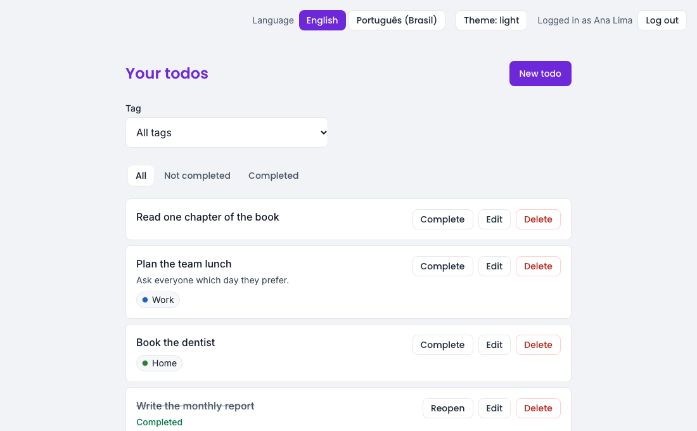
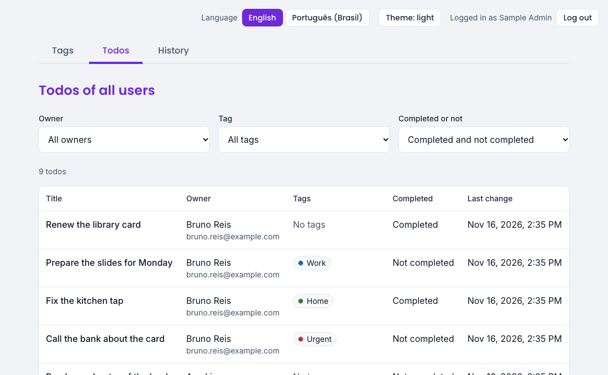

# monorepo-boilerplate

A starting point for a new web product: one repository with a Django server, two Next.js web apps, a component catalog, tests, and a fixed way of working with AI coding agents (Claude Code and Cursor). One command copies it into a project of your own, and a second command brings the later improvements of the boilerplate into that project.

**Why it exists.** A new product needs the same things before its first feature: a login, a database, tests, an automatic check, and rules for the AI agents that write the code. Setting them up takes days, and each project does it a little differently. Here they are set up once, tested, and kept up to date. Toraline, the GitHub organization that also publishes the component library `@toraline.tech/ui`, starts its own projects from it.

| The public web app (`apps/web`) | The internal app for admins (`apps/internal`) |
|---|---|
|  |  |

The pictures show the sample product with invented sample data.

## What is inside

| Part | What you get |
|---|---|
| A way of working with AI agents | 20 core skills, a team pack of 14 skills, 3 rule files, and scripts for worktrees, checks and secrets. It is the same in every project, and it works in Claude Code and in Cursor |
| A small sample product | A todo list with tags and a history of changes. A user manages their todos in the web app; an admin manages the tags and sees the todos of all users in the internal app. You keep it as a model, or the create command removes it |
| The server, `apps/api` | Django 5.2, Django REST Framework, PostgreSQL 17. Login with a session cookie and CSRF, a limit on login attempts, users, the Django admin |
| The web apps, `apps/web` and `apps/internal` | Next.js 16, React 19, TypeScript, Tailwind CSS 4. A login page, English and Portuguese (Brazil), a light and a dark theme, security headers |
| The component catalog, `apps/ui-catalog` | Storybook 10 with the components in the theme of the project |
| Shared code, `packages/shared` and `packages/ui` | The requests to the server, the login, the languages; the theme and the components of the project |
| Tests and checks | Tests for every part, end-to-end tests in a real browser (Playwright), one command for all of them (`make check`), and the same check on GitHub for each pull request |
| Two commands | `npx create-toraline-monorepo` starts a project. `npx update-toraline-monorepo`, run later inside that project, applies what the boilerplate changed since then and writes a plan for an AI agent, which does the rest |

Nothing in this repository is a real key or real data. Values that are yours go into `.env`, which is never committed.

## Try it

You need git, Node 24, Python 3.13 and Docker Desktop, which must be running. Linear, Claude Code and Cursor are optional: only the way of working with AI agents uses them.

Start a project of your own:

```bash
npx create-toraline-monorepo my-project
cd my-project
make setup
make run
```

Or run the boilerplate as it is:

```bash
git clone https://github.com/Toraline/monorepo-boilerplate.git
cd monorepo-boilerplate
make setup
make run
```

Then open `http://localhost:3000` and log in with the values of `SEED_ADMIN_EMAIL` and `SEED_ADMIN_PASSWORD` of the file `.env`. Both are invented sample values. `make seed-sample` adds 2 sample users with todos. Ctrl+C stops the apps, and `make db-down` stops the database.

## Read next

1. [docs/start-a-new-monorepo.md](docs/start-a-new-monorepo.md): from an empty folder to a running project of your own.
2. [docs/setup-guide.md](docs/setup-guide.md): the tools, the file `.env`, the commands, and the rules about secrets.
3. [docs/workflow/working-pattern.md](docs/workflow/working-pattern.md): how a ticket becomes a pull request with an AI agent.
4. [apps/api/README.md](apps/api/README.md): the server, with its settings, its login and every request.
5. [docs/update-a-monorepo.md](docs/update-a-monorepo.md): how a project gets the later changes of the boilerplate.

## What is where

```
monorepo-boilerplate/
├── apps/              one folder per app (a server or a site)
│   ├── api/           the server (Django, Django REST Framework, PostgreSQL)
│   ├── web/           the public web app (Next.js), on port 3000
│   ├── internal/      the internal app, for admins only (Next.js), on port 3001
│   └── ui-catalog/    the catalog of the components (Storybook), on port 6006
├── packages/          one folder per package (code that the apps share)
│   ├── shared/        the code of both web apps that is not user interface: the requests to the server
│   └── ui/            the theme of this project and the components that only this project has
├── e2e/               the end-to-end tests: Playwright opens apps/web in a real browser
├── cli/               the two npm commands: create-toraline-monorepo and update-toraline-monorepo
├── boilerplate/       the version of this boilerplate, the updates of each release, what the create command changes
├── agent/             the way of working with AI agents
│   ├── skills/        the skills
│   ├── rules/         writing, git safety, ask-first
│   └── templates/     templates for a new skill and for a project's AGENTS.md
├── scripts/           worktree, doctor, sync, guard, secret check, database, server install
├── .github/workflows/ the automatic check on GitHub: make check, then make e2e, on each pull request to main
├── docs/              the guides to start and to update a monorepo, the setup guide, the decisions, the workflow
├── AGENTS.md          entry file for agents, with the project profile
├── Makefile           every command of the repository
├── package.json       the npm workspace: the JavaScript apps and packages
├── docker-compose.yml the database of the local machine: PostgreSQL in Docker
├── .env.example       every variable, with an invented sample value
├── .nvmrc             the Node version
└── .python-version    the Python version
```

| Path | Content |
|---|---|
| `apps/` | The apps. [apps/README.md](apps/README.md) lists them |
| `apps/api/` | The server. [apps/api/README.md](apps/api/README.md) has its folders, commands, settings and requests |
| `apps/web/`, `apps/internal/` | The two web apps. [apps/web/README.md](apps/web/README.md) and [apps/internal/README.md](apps/internal/README.md) have their folders, commands and settings |
| `apps/ui-catalog/` | The catalog of the components. [apps/ui-catalog/README.md](apps/ui-catalog/README.md) has its commands and how to add a story |
| `packages/` | The code that the apps share. [packages/README.md](packages/README.md) lists the packages |
| `e2e/` | The 2 end-to-end tests. [e2e/README.md](e2e/README.md) says how to run them and how to add a test |
| `cli/` | The code of the two npm commands. [cli/README.md](cli/README.md) has its commands and how to try a command on your machine |
| `boilerplate/` | `VERSION` (the version of this boilerplate), `updates/` (one file per release) and `create-manifest.json` (what `create-toraline-monorepo` changes in a copy). [docs/boilerplate-version.md](docs/boilerplate-version.md) |
| `.github/workflows/release.yml` | The workflow "Release", started by hand: it publishes the two commands to npm and creates the tag of the version. [docs/releasing.md](docs/releasing.md) |
| `docs/repositories.md` | Why this repository holds no list of the repositories that were created from it, and where the owner keeps that list |
| `LICENSE` | The license of this repository: MIT |
| `SECURITY.md`, `CONTRIBUTING.md` | How to report a vulnerability in private, and how to report a bug or propose a change |
| `.github/pull_request_template.md` | The text that a new pull request starts with |
| `.editorconfig` | The indentation and the line ends of each kind of file, for every editor |
| `docs/images/` | The 2 pictures at the top of this file |
| `package.json`, `package-lock.json` | The npm workspace. It links the JavaScript apps and packages. `apps/api` is Python and is not in it |
| `.nvmrc` | The Node version: 24 |
| `.python-version` | The Python version: 3.13. The server `apps/api` needs it |
| `Makefile` | Every command. `make help` lists them |
| `docker-compose.yml` | One PostgreSQL 17 server in Docker, for the local machine. Each checkout has its own |
| `.env.example` | Every variable with an invented sample value. `.env` is your copy; git ignores it |
| `AGENTS.md` | Entry file for agents, with the project profile |
| `agent/skills/` | The skills. `.claude/skills` and `.cursor/skills` are links to this folder |
| `agent/rules/` | Writing, git safety, ask-first |
| `agent/templates/` | Templates for a new skill and for a project's `AGENTS.md` |
| `scripts/` | Worktree, doctor, sync, guard, secret check, the database commands, the install of the server |
| `docs/start-a-new-monorepo.md` | How to start your own monorepo from this repository: the command, or 11 steps by hand |
| `docs/update-a-monorepo.md` | How a monorepo gets the later changes of the boilerplate: the command `update-toraline-monorepo` and the skill `/update-boilerplate` |
| `docs/setup-guide.md` | How to set this up on your machine and in your own project |
| `docs/languages.md` | English and Portuguese (Brazil) in the web apps: how to add a text and a language |
| `docs/theme.md` | The theme of the web apps: how to change a color, add a component of the project, update the component library |
| `docs/decisions.md` | The technical decisions, each with its reason |
| `docs/workflow/` | The flow, where things live, the skill catalog, the model for a new module |
| `local-docs/` | Your private notes. Made per user, never committed |

## Use the core in another project

```bash
bash ~/code/repos/monorepo-boilerplate/scripts/sync-skills.sh /path/to/your/project
```

The steps are in the setup guide.

## Security and contributions

To report a vulnerability in private: [SECURITY.md](SECURITY.md). To report a bug or propose a change: [CONTRIBUTING.md](CONTRIBUTING.md).

## License

MIT. The full text is in the file [LICENSE](LICENSE). You may copy, change and use this repository, also in a product that you sell. The one condition: keep the copyright notice and the license text in your copy.

A monorepo that you create with `npx create-toraline-monorepo` is your own project. It does not get this file: you choose its license yourself.
